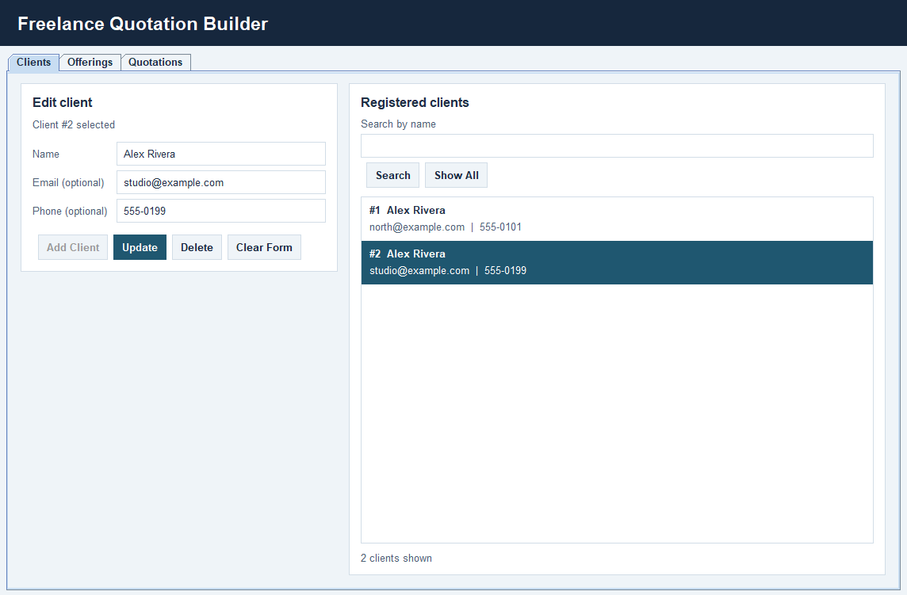
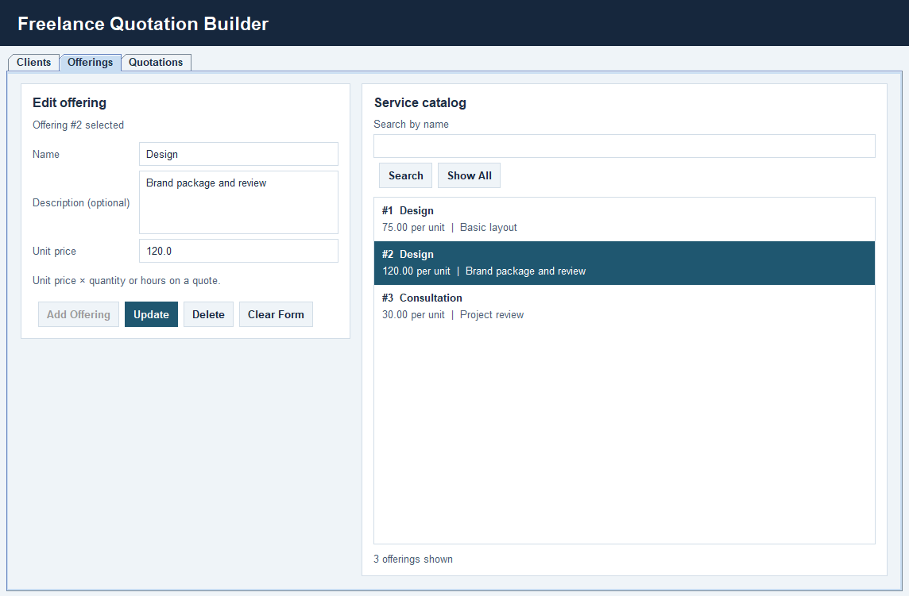
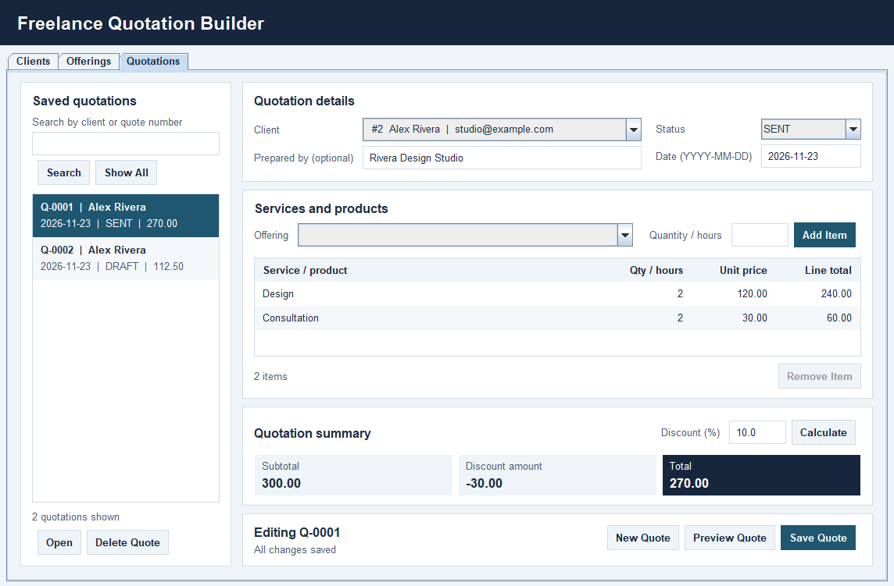
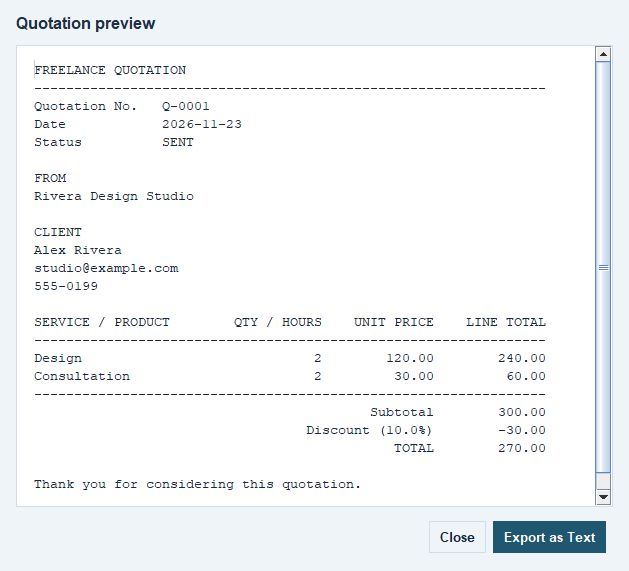

# Freelance Quotation Builder

Universidad Politécnica Taiwán-Paraguay · Java Programming · Semester 2026.2

## Problem and objectives

Freelancers often rebuild price estimates from separate contact lists, price lists, and spreadsheets. This can cause inconsistent totals and make previous terms hard to reconstruct after rates change. The application gives a freelancer one place to keep client details and a service catalog, prepare a quotation, calculate its cost, and track its status.

## System design

The freelancer enters contacts, offerings, quantities, dates, and discounts in three Swing tabs. Each panel reads from the same `DataStore`, which manages private `ArrayList` collections. The quote editor separates the quotation details, service lines, totals, and save actions. The output is a numbered saved quotation that can be reviewed in Swing or exported as a UTF-8 text document.

| Class | Responsibility |
| --- | --- |
| `Main`, `MainFrame` | Start Swing, create one shared store, and host the navigation tabs |
| `Client`, `Offering` | Validate and store contact details and service catalog entries |
| `QuoteItem` | Reference an offering and keep the agreed price, quantity, and line calculation |
| `Quote` | Reference a client, hold the item list and quote details, and calculate subtotal, discount amount, and total |
| `DataStore` | Find and change records, assign stable quote numbers, and protect their relationships |
| `DataFile` | Read and write a text snapshot and restore references to the correct loaded objects |
| `ClientsPanel`, `OfferingsPanel`, `QuotesPanel` | Read forms, respond to Swing events, show validation messages, and refresh the display |
| `FormPanel`, `RecordRenderer`, `SwingStyle` | Align fields, render list records and line-item columns, and apply a consistent visual style |
| `QuotePreview` | Format the quote for review and write the same text to a user-selected file |

The source demonstrates primitive variables, strings, conditions, loops, methods, constructors, encapsulation, `ArrayList`, and object relationships. Panels extend Swing classes, use layout managers such as `BorderLayout` and `GridBagLayout`, and respond to button and selection listeners. A small panel implements Swing's `Scrollable` interface so the quote editor follows the window width. Input and file errors are handled with exceptions. Text storage uses the buffered reading and writing covered in Unit 15.

## Operations and validation

The Clients and Offerings tabs add, display, search, update, and delete records. A loop checks each name for the search text with letter case ignored. Selecting a row loads that object's fields. Updates validate all replacement values before changing the original object. Duplicate names are allowed, and delete uses the selected record after confirmation.

The Quotations tab creates, opens, searches, updates, and deletes quotations. Each line multiplies the quantity by the unit price at the time it was added. The subtotal sums all line totals. The discount amount is the subtotal multiplied by the discount fraction, and the final total applies that discount. For example, two units at 120 and two at 30 produce a subtotal of 300.00, a discount of 30.00, and a total of 270.00. Draft changes reach a saved record only after a successful save. The editor prompts before an action would discard unsaved edits.

The program uses validation and Swing dialogs for missing selections, blank required names, an email without `@`, invalid dates, missing status, invalid numerical text, non-finite numbers, out-of-range discounts, and overflow. Empty quotations display zero and require at least one line for saving or previewing. The store prevents deleting clients and offerings used in saved quotations. The preview reads the same quote data and model totals as the editor. The sender appears only when the user entered a name.

## Text storage

The application saves each successful change to `data/quotations.txt`. The file lists clients, offerings, quotations, and their item records. Each quotation refers to its client's position in that snapshot, and each item refers to the offering's position. The reader creates those objects first and uses the stored positions to reconnect them. Each quote has its own saved number, while each item also has its own saved unit price. The saved next-number value continues the sequence after deletions and restarts.

`DataFile` writes a temporary snapshot before replacing the previous file. If a write fails, `DataStore` restores the affected record and the panel displays an error. The reader validates the file and checks its ending marker. A malformed file opens the application in a temporary session, preserving the file for recovery.

## Testing and actual results

The application and tests compiled on Windows with Temurin JDK 25.0.4.1 using `javac --release 11`. Both test programs passed in a graphical Windows session.

| Executed test | Result |
| --- | --- |
| `ModelTest` client and offering groups | Passed. Verified partial searches, duplicate records, deletion, zero price, negative prices, and non-finite values. |
| `ModelTest` calculation and saved quote groups | Passed. Verified empty and multi-item totals, discounts of 0%, 10%, 25%, and 100%, overflow, protected references, and stable quote numbers. |
| `ModelTest` persistence group | Passed. Verified missing and malformed data files, restart with duplicates and shared references, preserved prices, and rollback and retry after a failed write. |
| `SwingTest` client and offering groups | Passed. Exercised forms, list selections, updates, searches, confirmation, and invalid input in the real window. |
| `SwingTest` quotation and integration groups | Passed. Exercised item changes, totals, save and reopen, searches by quote number and client, unsaved-change prompts, and synchronization across tabs. Verified the minimum-size layout, preview contents, and text export through the file chooser. |
| `Main` startup smoke checks | Passed. A fresh JVM reopened a saved quote and retained its agreed price. A separate launch with a malformed file displayed a temporary-session warning and preserved that file. |

All nine groups passed on the final build. The Swing test drove the real window through its components. The images below were captured from that run with sample records and visually reviewed.

## GUI screenshots

**Clients** · Duplicate names with distinct contact details.

**Offerings** · Two Design offerings with distinct unit prices and descriptions.

**Quotations** · Reopened quotation with two line items, a subtotal of 300.00, and a discounted total of 270.00.

**Preview** · The same quote formatted as an itemized document that can be exported as text.

## Limitations

The local file is designed for a single running application. Catalog names and contact details remain linked to their current records, while each item keeps its agreed unit price. The application assumes one currency and uses `double` arithmetic with rounded display amounts. The project was verified through model, Swing, and startup checks on Windows.
